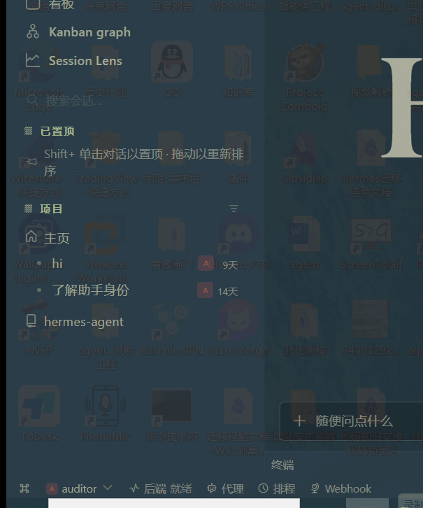
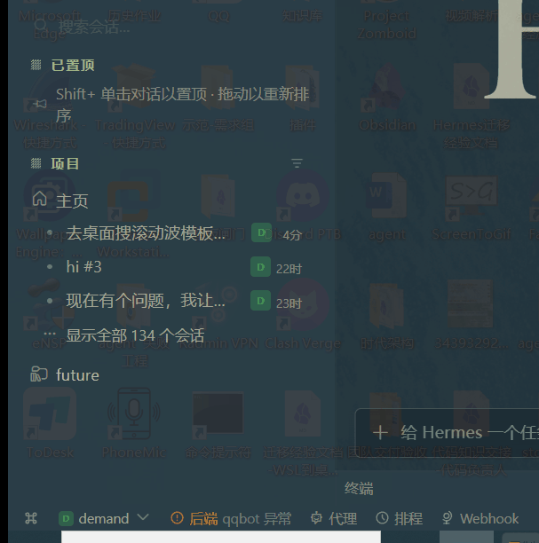

# Hermes Agent desktop: fix stale session list after switching profiles

> A patch for [Hermes Agent](https://github.com/NousResearch/hermes-agent) (Nous Research) desktop app.
> After you pick another profile in the sidebar, the session list keeps showing the **previous profile's
> sessions** for several seconds — and in the grouped "all projects" view, until you hit Refresh.
> This patch clears the outgoing profile's rows at click time, arms the loading skeleton, and repaints the
> target profile's sessions.

[中文说明见下方](#中文说明)

This is **not a cosmetic glitch**. Picking a profile is how you hand a task to the right agent. When the
sidebar keeps the outgoing agent's sessions, you open the new session — or resume an old one — in the
**wrong agent**, and the work lands on the wrong role. Silently: nothing on screen tells you that you are
still sitting in the previous agent. The patch restores one rule: *what you see after a pick must already
belong to the agent you picked.*

## Symptoms this fixes

| Symptom you may have searched for | Before | After |
|---|---|---|
| **Old sessions shown after switching profile** | the previous profile's rows stay painted for 2–8 s (as long as `hermes gateway ensure` dials) | the list clears at click time and the skeleton shows |
| **Sessions not refreshing after profile switch** | needs a manual sidebar Refresh | the new profile's list, projects and project tree are pulled automatically |
| **Wrong / stale sessions in the sidebar** (grouped view) | the grouped sidebar reads `$projectTree`, so wiping the session list left the outgoing profile's rows painted | the project scope and tree are reset in the same synchronous step |
| **Sidebar jumps back to the default profile's list** | activating a shared primary socket announced route `default` | activation announces the profile it actually serves |

Keywords: `hermes-agent` · `hermes desktop` · `profile switch` · `profile switcher` · `stale sessions` ·
`old sessions` · `wrong sessions` · `session list not refreshing` · `multi-profile` · `sidebar` ·
`electron` · `react` · `nanostores` · `gateway` · `wrong agent` · `task routed to the wrong profile` ·
`responsibility pollution` · `context pollution` · `multi-agent workflow` · `agent routing`

## Wrong agent, wrong task: responsibility and context pollution

In multi-agent use the sidebar **is** the routing UI — it is how a task gets handed to the role that should
own it. A stale list therefore does not just look wrong, it *routes* wrong:

- **Wrong agent, wrong session.** You pick agent B to open a session for job X, but the list still shows
  agent A's sessions. The new session is created under A, or you resume one of A's sessions thinking it is
  B's.
- **Responsibility pollution.** The work lands on a role that was never meant to own it. Later nobody can
  say which agent did what, and the right agent never saw the task at all.
- **Context pollution.** That session now mixes two mandates. The next agent (or the next you) reads a
  history that carries another role's background — decisions get made on contaminated context.
- **No brake.** During the 2–8 s dial the stale rows stay *clickable*, so nothing forces you to wait for the
  list to settle. One fast click is enough.

Anyone coming from a multi-agent setup searches for the consequence rather than the symptom: `task sent to
wrong agent`, `opened session in wrong profile`, `agent role confusion`, `context pollution between agents`,
`mix up which agent did what`. That is what this patch is really about.

## Before / after (recorded 2026-11-14)

| Before: stale sessions after a profile switch | After: list cleared, then the target profile's rows |
|---|---|
|  |  |

Both clips: pick a profile in the bottom-left dropdown, do not send a message, watch the sidebar for ~5 s.
Same machine, same pair of profiles (50 rows vs 29 rows, so the swap is visible). See [REPRO.md](REPRO.md).

## What is inside the patch

One commit, 22 files, +664/−50 — three independent fixes, described in detail in
[`docs/root-cause.md`](docs/root-cause.md):

1. **Switch barrier** — `apps/desktop/src/store/gateway-switch.ts` gains `beginProfileSwitch()`: it wipes
   `$sessions` / `$cronSessions` / `$messagingSessions`, arms `$sessionsLoading`, and resets the project tree,
   synchronously at pick time, before the dial starts. `apps/desktop/src/store/profile.ts` `selectProfile()`
   sets `$profileSwitchTarget` and calls the bridge, and `use-session-actions` refuses to open an outgoing
   profile's session while a switch is in flight.
2. **Active refresh** — `apps/desktop/src/app/contrib/wiring-effects.ts` `useGatewayScopeRefresh()` re-pulls
   sessions, projects and the project tree when the profile scope moves; a failed switch repaints the
   still-active source instead of sitting on skeletons.
3. **Route announcement** — `apps/desktop/src/store/gateway.ts` `applyActive()` learns a `servedProfile`
   argument, so activating a shared primary socket publishes the profile it serves instead of the socket's own
   name (`default`), which was mirroring `$activeGatewayProfile` back to `default` and pulling the wrong list.
   The rides-primary path of `ensureGatewayForAgent()` now returns early when the route already points at the
   requested profile, instead of announcing.
4. **Publish guard** — `apps/desktop/src/app/session/hooks/use-session-list-actions.ts` compares the live
   `$profileScope` before publishing a fetched page and strands pages that belong to a profile the window is
   leaving.

Two new test files ship with it and fail on the unpatched tree:

- `apps/desktop/src/store/profile-switch-barrier.test.ts` (4 cases)
- `apps/desktop/src/app/contrib/wiring-effects.gateway-scope-refresh.test.tsx` (5 cases)

## Apply

The patch is generated against `NousResearch/hermes-agent` @ `8531ae7bb0` (2026-11-08). Upstream `main` has
moved since; `git am -3` usually resolves the context drift.

```bash
git clone https://github.com/NousResearch/hermes-agent.git
cd hermes-agent
git checkout -b profile-switch-fix 8531ae7bb0
git am -3 /path/to/patches/hermes-desktop-profile-switch-fix.patch

cd apps/desktop
npx tsc -p tsconfig.json --noEmit                       # expect: no output, exit 0
npx vitest run src/store/profile-switch-barrier.test.ts \
               src/app/contrib/wiring-effects.gateway-scope-refresh.test.tsx
# expect: Test Files 2 passed
```

Then rebuild the desktop app and restart it — a `dist` swap alone changes nothing while the app is running:

```bash
cd apps/desktop
node scripts/build.mjs        # ~1 min; rotates the old dist to .dist-previous-*
```

Quit Hermes from the tray icon (right-click → Quit, not just the window) and reopen.

If your upstream tree has diverged, conflicts concentrate in
`apps/desktop/src/store/gateway.ts` and `apps/desktop/src/store/gateway-switch.ts`.

## Status

- Not merged upstream; no upstream issue filed at the time of writing.
- **Unofficial.** This is a community patch, not affiliated with or endorsed by Nous Research. Hermes Agent
  itself is MIT-licensed; the `LICENSE` here keeps the original copyright notice as MIT requires.
- Verified on 2026-11-14: `tsc` clean, `76 passed` across the six affected suites.
- MIT, same as upstream. Hermes Agent is © 2025 Nous Research; this patch only adds to it.

## 中文说明

### 为什么会把活派错 agent（职责越界 / 上下文污染）

切 profile 说白了就是"换人干活"。列表还挂着**上一个 agent** 的会话时，你照着它去开新会话、去翻历史会话，
会话就开在了错的 agent 里；活派下去，接手的是**不该负责这件事的那个角色**——该干的没干，不该干的干了，
事后还分不清是谁做的。这就是**职责越界**。

同一份会话里还会混进两套职责的背景，即**上下文污染**：下一个接手的人（或下一个 agent）读到的是掺过的历史，
等于踩在脏地基上继续盖楼。

最坑的是它**不吭声**：屏幕上没有一句提示告诉你"其实还在上一个 agent 里"；而且切换途中的那 4~8 秒，
旧会话**还能点开**，手快一点直接就进去了，连"等一下"的机会都不给。

修完的规则只有一条：**点完切过去，屏幕上看到的东西就该是你切过去那个 agent 的。**

**这段解决什么麻烦**：Hermes 桌面版左下角切 profile（换账号 / 换身份）之后，会话列表还显示**上一个
profile 的会话**，要等几秒才变对，有时必须右键手动刷新。打完这个补丁：点击瞬间列表清空并显示加载状态，
随后填入目标 profile 的正确列表；项目分组视图也不会再画旧 profile 的会话条。

**三个独立修复**：

1. **切换瞬间拦界面** —— `beginProfileSwitch()` 在拨号前同步清空会话 / 定时任务 / 消息列表 + 亮加载态 +
   清项目树；切换在途时禁止点进旧会话。
2. **切完主动重拉** —— profile scope 一变就重拉会话列表、项目概览、项目树；切换失败则重绘仍然生效的那份，
   不会一直卡在骨架屏。
3. **共享主连接播报真正服务的 profile** —— 本地多 profile 共用一个 primary socket 时，激活报的是
   socket 自己的名字（`default`），侧栏就被拽回默认账号的列表。修法是激活时播报**被服务的那个** profile，
   而后台拨号若路由已指向目标 profile 则直接放行、不重复播报。

**怎么用**：见上面 Apply 段。补丁基线 `8531ae7bb0`，用 `git am -3` 应用；改完 `node scripts/build.mjs`，
然后托盘彻底退出 Hermes 再打开（只关窗口不生效）。

**四个缺陷的定位过程**：见 [`docs/root-cause.md`](docs/root-cause.md)。
**怎么复现坏版**：见 [REPRO.md](REPRO.md)。
